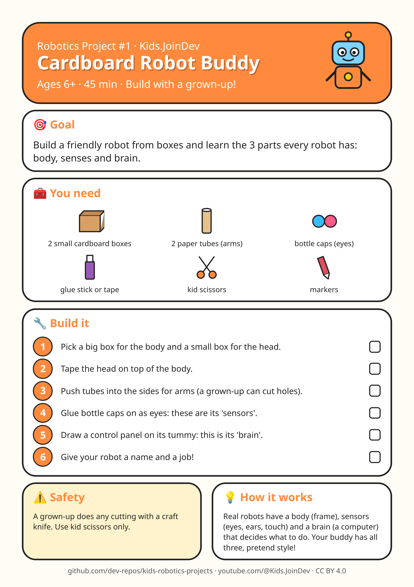

# Project 1: Cardboard Robot Buddy

**Ages:** 6+ · **Time:** 45 min · Build with a grown-up.

Printable A4 build-steps sheet: [card.png](card.png) · [card.pdf](card.pdf)

**1:1 cut/fold templates (print at 100% / Actual size, do not fit to page):** [templates.pdf](templates.pdf) (preferred) · [template 1 PNG](template-1.png) · [template 2 PNG](template-2.png) · [template 3 PNG](template-3.png). Check the 100 mm calibration bar first. Solid = cut, dashed = fold, grey circles = holes, red = size in mm.

## Goal

{p["goal"]}

## Parts list

- 2 small cardboard boxes
- 2 paper tubes (arms)
- bottle caps (eyes)
- glue stick or tape
- kid scissors
- markers

## Steps

1. Pick a big box for the body and a small box for the head.
2. Tape the head on top of the body.
3. Push tubes into the sides for arms (a grown-up can cut holes).
4. Glue bottle caps on as eyes: these are its 'sensors'.
5. Draw a control panel on its tummy: this is its 'brain'.
6. Give your robot a name and a job!

## Safety with a grown-up

A grown-up does any cutting with a craft knife. Use kid scissors only.

## How it works

Real robots have a body (frame), sensors (eyes, ears, touch) and a brain (a computer) that decides what to do. Your buddy has all three, pretend style!

## Coding piece

No code in this one: it is all hands-on building. 🛠️

## Try next

Change one thing (size, weight, speed, number) and see what happens. Draw what you built!
