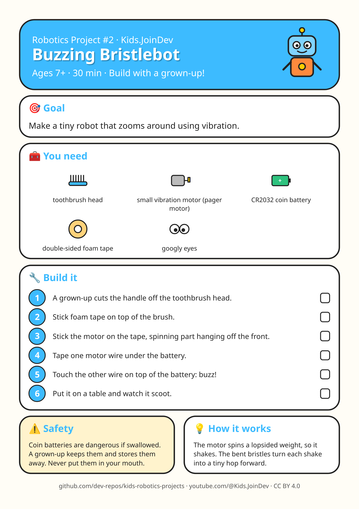

# Project 2: Buzzing Bristlebot

**Ages:** 7+ · **Time:** 30 min · Build with a grown-up.

Printable A4 build-steps sheet: [card.png](card.png) · [card.pdf](card.pdf)

**1:1 cut/fold templates (print at 100% / Actual size, do not fit to page):** [templates.pdf](templates.pdf) (preferred) · [template 1 PNG](template-1.png). Check the 100 mm calibration bar first. Solid = cut, dashed = fold, grey circles = holes, red = size in mm.

## Goal

{p["goal"]}

## Parts list

- toothbrush head
- small vibration motor (pager motor)
- CR2032 coin battery
- double-sided foam tape
- googly eyes

## Steps

1. A grown-up cuts the handle off the toothbrush head.
2. Stick foam tape on top of the brush.
3. Stick the motor on the tape, spinning part hanging off the front.
4. Tape one motor wire under the battery.
5. Touch the other wire on top of the battery: buzz!
6. Put it on a table and watch it scoot.

## Safety with a grown-up

Coin batteries are dangerous if swallowed. A grown-up keeps them and stores them away. Never put them in your mouth.

## How it works

The motor spins a lopsided weight, so it shakes. The bent bristles turn each shake into a tiny hop forward.

## Coding piece

No code in this one: it is all hands-on building. 🛠️

## Try next

Change one thing (size, weight, speed, number) and see what happens. Draw what you built!
