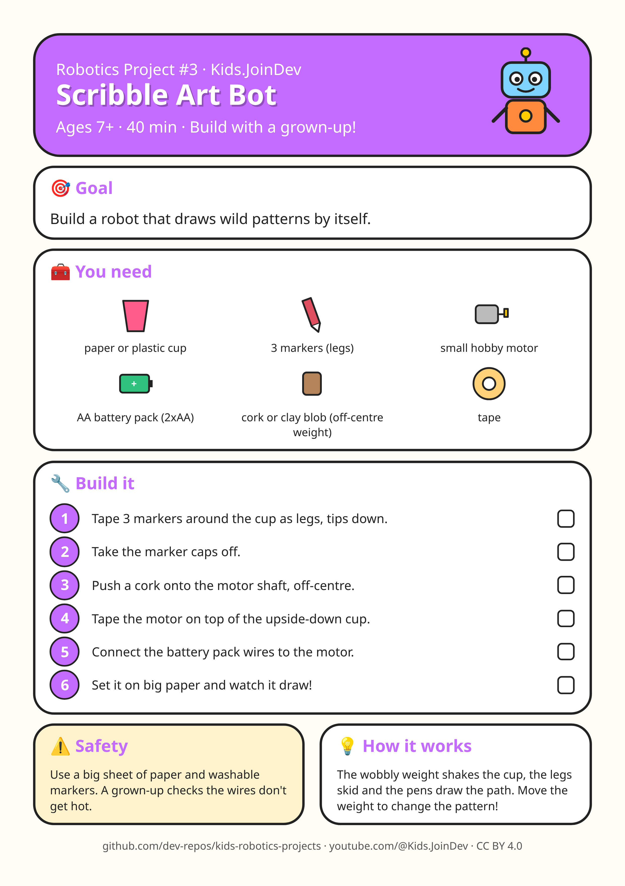

# Project 3: Scribble Art Bot

**Ages:** 7+ · **Time:** 40 min · Build with a grown-up.

Printable A4 build-steps sheet: [card.png](card.png) · [card.pdf](card.pdf)

**1:1 cut/fold templates (print at 100% / Actual size, do not fit to page):** [templates.pdf](templates.pdf) (preferred) · [template 1 PNG](template-1.png). Check the 100 mm calibration bar first. Solid = cut, dashed = fold, grey circles = holes, red = size in mm.

## Goal

{p["goal"]}

## Parts list

- paper or plastic cup
- 3 markers (legs)
- small hobby motor
- AA battery pack (2xAA)
- cork or clay blob (off-centre weight)
- tape

## Steps

1. Tape 3 markers around the cup as legs, tips down.
2. Take the marker caps off.
3. Push a cork onto the motor shaft, off-centre.
4. Tape the motor on top of the upside-down cup.
5. Connect the battery pack wires to the motor.
6. Set it on big paper and watch it draw!

## Safety with a grown-up

Use a big sheet of paper and washable markers. A grown-up checks the wires don't get hot.

## How it works

The wobbly weight shakes the cup, the legs skid and the pens draw the path. Move the weight to change the pattern!

## Coding piece

No code in this one: it is all hands-on building. 🛠️

## Try next

Change one thing (size, weight, speed, number) and see what happens. Draw what you built!
