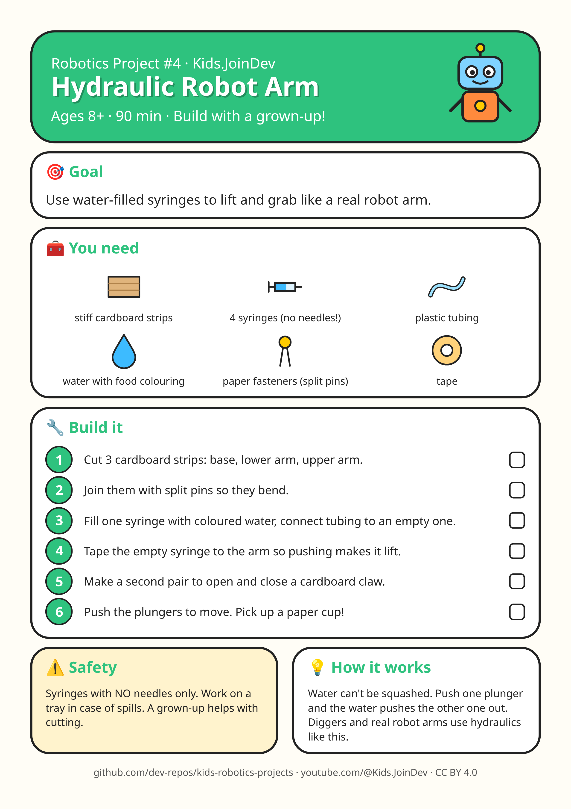

# Project 4: Hydraulic Robot Arm

**Ages:** 8+ · **Time:** 90 min · Build with a grown-up.

Printable A4 build-steps sheet: [card.png](card.png) · [card.pdf](card.pdf)

**1:1 cut/fold templates (print at 100% / Actual size, do not fit to page):** [templates.pdf](templates.pdf) (preferred) · [template 1 PNG](template-1.png) · [template 2 PNG](template-2.png). Check the 100 mm calibration bar first. Solid = cut, dashed = fold, grey circles = holes, red = size in mm.

## Goal

{p["goal"]}

## Parts list

- stiff cardboard strips
- 4 syringes (no needles!)
- plastic tubing
- water with food colouring
- paper fasteners (split pins)
- tape

## Steps

1. Cut 3 cardboard strips: base, lower arm, upper arm.
2. Join them with split pins so they bend.
3. Fill one syringe with coloured water, connect tubing to an empty one.
4. Tape the empty syringe to the arm so pushing makes it lift.
5. Make a second pair to open and close a cardboard claw.
6. Push the plungers to move. Pick up a paper cup!

## Safety with a grown-up

Syringes with NO needles only. Work on a tray in case of spills. A grown-up helps with cutting.

## How it works

Water can't be squashed. Push one plunger and the water pushes the other one out. Diggers and real robot arms use hydraulics like this.

## Coding piece

No code in this one: it is all hands-on building. 🛠️

## Try next

Change one thing (size, weight, speed, number) and see what happens. Draw what you built!
