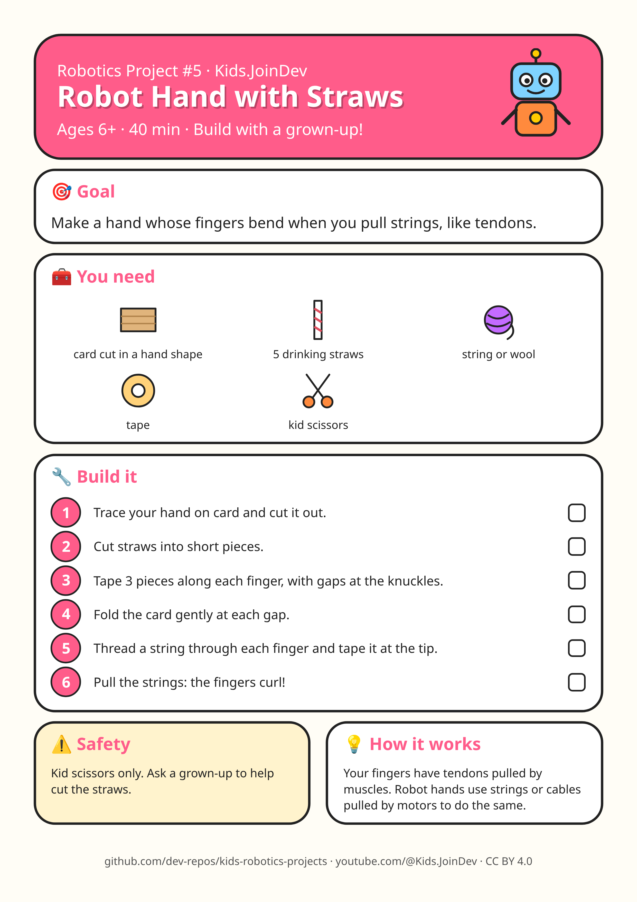

# Project 5: Robot Hand with Straws

**Ages:** 6+ · **Time:** 40 min · Build with a grown-up.

Printable A4 build-steps sheet: [card.png](card.png) · [card.pdf](card.pdf)

**1:1 cut/fold templates (print at 100% / Actual size, do not fit to page):** [templates.pdf](templates.pdf) (preferred) · [template 1 PNG](template-1.png) · [template 2 PNG](template-2.png). Check the 100 mm calibration bar first. Solid = cut, dashed = fold, grey circles = holes, red = size in mm.

## Goal

{p["goal"]}

## Parts list

- card cut in a hand shape
- 5 drinking straws
- string or wool
- tape
- kid scissors

## Steps

1. Trace your hand on card and cut it out.
2. Cut straws into short pieces.
3. Tape 3 pieces along each finger, with gaps at the knuckles.
4. Fold the card gently at each gap.
5. Thread a string through each finger and tape it at the tip.
6. Pull the strings: the fingers curl!

## Safety with a grown-up

Kid scissors only. Ask a grown-up to help cut the straws.

## How it works

Your fingers have tendons pulled by muscles. Robot hands use strings or cables pulled by motors to do the same.

## Coding piece

No code in this one: it is all hands-on building. 🛠️

## Try next

Change one thing (size, weight, speed, number) and see what happens. Draw what you built!
