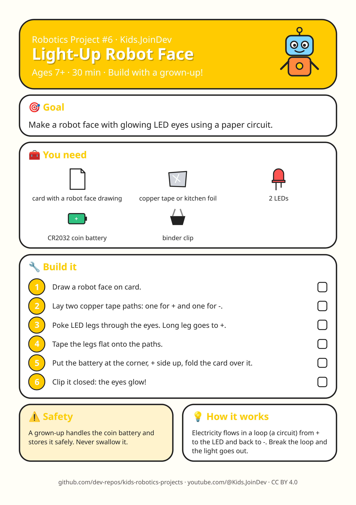

# Project 6: Light-Up Robot Face

**Ages:** 7+ · **Time:** 30 min · Build with a grown-up.

Printable A4 build-steps sheet: [card.png](card.png) · [card.pdf](card.pdf)

**1:1 cut/fold templates (print at 100% / Actual size, do not fit to page):** [templates.pdf](templates.pdf) (preferred) · [template 1 PNG](template-1.png). Check the 100 mm calibration bar first. Solid = cut, dashed = fold, grey circles = holes, red = size in mm.

## Goal

{p["goal"]}

## Parts list

- card with a robot face drawing
- copper tape or kitchen foil
- 2 LEDs
- CR2032 coin battery
- binder clip

## Steps

1. Draw a robot face on card.
2. Lay two copper tape paths: one for + and one for -.
3. Poke LED legs through the eyes. Long leg goes to +.
4. Tape the legs flat onto the paths.
5. Put the battery at the corner, + side up, fold the card over it.
6. Clip it closed: the eyes glow!

## Safety with a grown-up

A grown-up handles the coin battery and stores it safely. Never swallow it.

## How it works

Electricity flows in a loop (a circuit) from + to the LED and back to -. Break the loop and the light goes out.

## Coding piece

No code in this one: it is all hands-on building. 🛠️

## Try next

Change one thing (size, weight, speed, number) and see what happens. Draw what you built!
