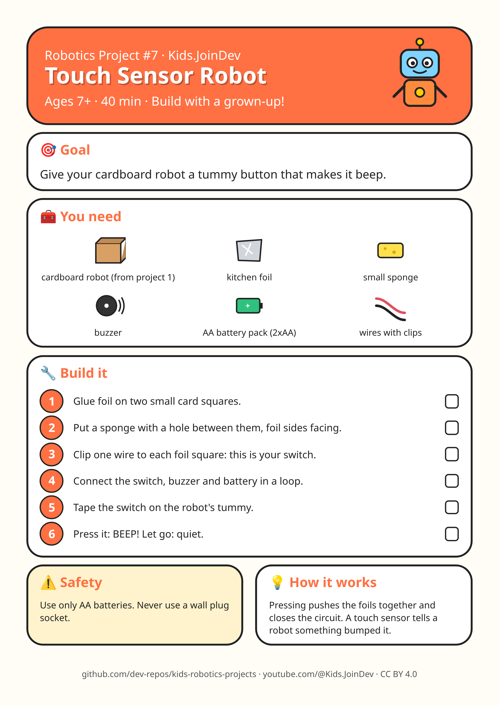

# Project 7: Touch Sensor Robot

**Ages:** 7+ · **Time:** 40 min · Build with a grown-up.

Printable A4 build-steps sheet: [card.png](card.png) · [card.pdf](card.pdf)

**1:1 cut/fold templates (print at 100% / Actual size, do not fit to page):** [templates.pdf](templates.pdf) (preferred) · [template 1 PNG](template-1.png). Check the 100 mm calibration bar first. Solid = cut, dashed = fold, grey circles = holes, red = size in mm.

## Goal

{p["goal"]}

## Parts list

- cardboard robot (from project 1)
- kitchen foil
- small sponge
- buzzer
- AA battery pack (2xAA)
- wires with clips

## Steps

1. Glue foil on two small card squares.
2. Put a sponge with a hole between them, foil sides facing.
3. Clip one wire to each foil square: this is your switch.
4. Connect the switch, buzzer and battery in a loop.
5. Tape the switch on the robot's tummy.
6. Press it: BEEP! Let go: quiet.

## Safety with a grown-up

Use only AA batteries. Never use a wall plug socket.

## How it works

Pressing pushes the foils together and closes the circuit. A touch sensor tells a robot something bumped it.

## Coding piece

No code in this one: it is all hands-on building. 🛠️

## Try next

Change one thing (size, weight, speed, number) and see what happens. Draw what you built!
