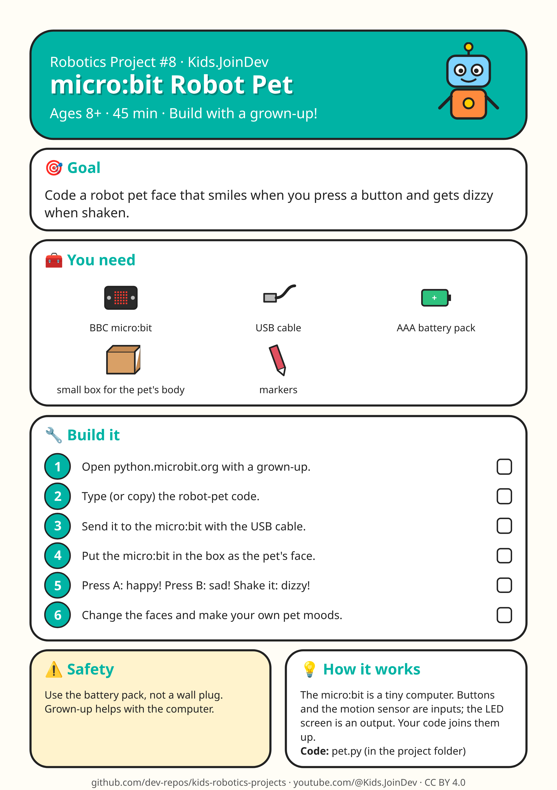

# Project 8: micro:bit Robot Pet

**Ages:** 8+ · **Time:** 45 min · Build with a grown-up.



Printable A4 build-steps sheet: [card.png](card.png) · [card.pdf](card.pdf)

**1:1 cut/fold templates (print at 100% / Actual size, do not fit to page):** [templates.pdf](templates.pdf) (preferred) · [template 1 PNG](template-1.png) · [template 2 PNG](template-2.png). Check the 100 mm calibration bar first. Solid = cut, dashed = fold, grey circles = holes, red = size in mm.

## Goal

{p["goal"]}

## Parts list

- BBC micro:bit
- USB cable
- AAA battery pack
- small box for the pet's body
- markers

## Steps

1. Open python.microbit.org with a grown-up.
2. Type (or copy) the robot-pet code.
3. Send it to the micro:bit with the USB cable.
4. Put the micro:bit in the box as the pet's face.
5. Press A: happy! Press B: sad! Shake it: dizzy!
6. Change the faces and make your own pet moods.

## Safety with a grown-up

Use the battery pack, not a wall plug. Grown-up helps with the computer.

## How it works

The micro:bit is a tiny computer. Buttons and the motion sensor are inputs; the LED screen is an output. Your code joins them up.

## Coding piece

See [`pet.py`](pet.py).

```python
# micro:bit Robot Pet (MicroPython) - python.microbit.org
from microbit import *

display.show(Image.HAPPY)
while True:
    if button_a.was_pressed():
        display.show(Image.HAPPY)
    elif button_b.was_pressed():
        display.show(Image.SAD)
    elif accelerometer.was_gesture('shake'):
        display.show(Image.CONFUSED)
        sleep(1000)
        display.show(Image.ASLEEP)
    sleep(100)
```

## Try next

Change one thing (size, weight, speed, number) and see what happens. Draw what you built!
