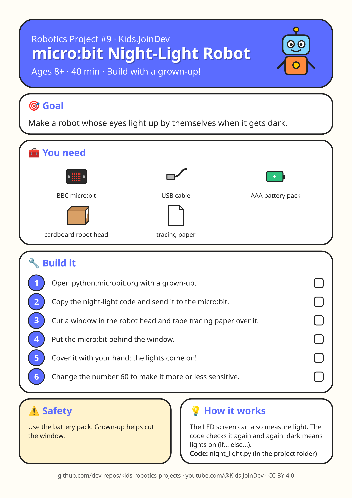

# Project 9: micro:bit Night-Light Robot

**Ages:** 8+ · **Time:** 40 min · Build with a grown-up.



Printable A4 build-steps sheet: [card.png](card.png) · [card.pdf](card.pdf)

**1:1 cut/fold templates (print at 100% / Actual size, do not fit to page):** [templates.pdf](templates.pdf) (preferred) · [template 1 PNG](template-1.png) · [template 2 PNG](template-2.png). Check the 100 mm calibration bar first. Solid = cut, dashed = fold, grey circles = holes, red = size in mm.

## Goal

{p["goal"]}

## Parts list

- BBC micro:bit
- USB cable
- AAA battery pack
- cardboard robot head
- tracing paper

## Steps

1. Open python.microbit.org with a grown-up.
2. Copy the night-light code and send it to the micro:bit.
3. Cut a window in the robot head and tape tracing paper over it.
4. Put the micro:bit behind the window.
5. Cover it with your hand: the lights come on!
6. Change the number 60 to make it more or less sensitive.

## Safety with a grown-up

Use the battery pack. Grown-up helps cut the window.

## How it works

The LED screen can also measure light. The code checks it again and again: dark means lights on (if... else...).

## Coding piece

See [`night_light.py`](night_light.py).

```python
# micro:bit Night-Light Robot (MicroPython)
from microbit import *

while True:
    light = display.read_light_level()   # 0 = dark ... 255 = bright
    if light < 60:
        display.show(Image('99999:99999:99999:99999:99999'))
    else:
        display.clear()
    sleep(200)
```

## Try next

Change one thing (size, weight, speed, number) and see what happens. Draw what you built!
