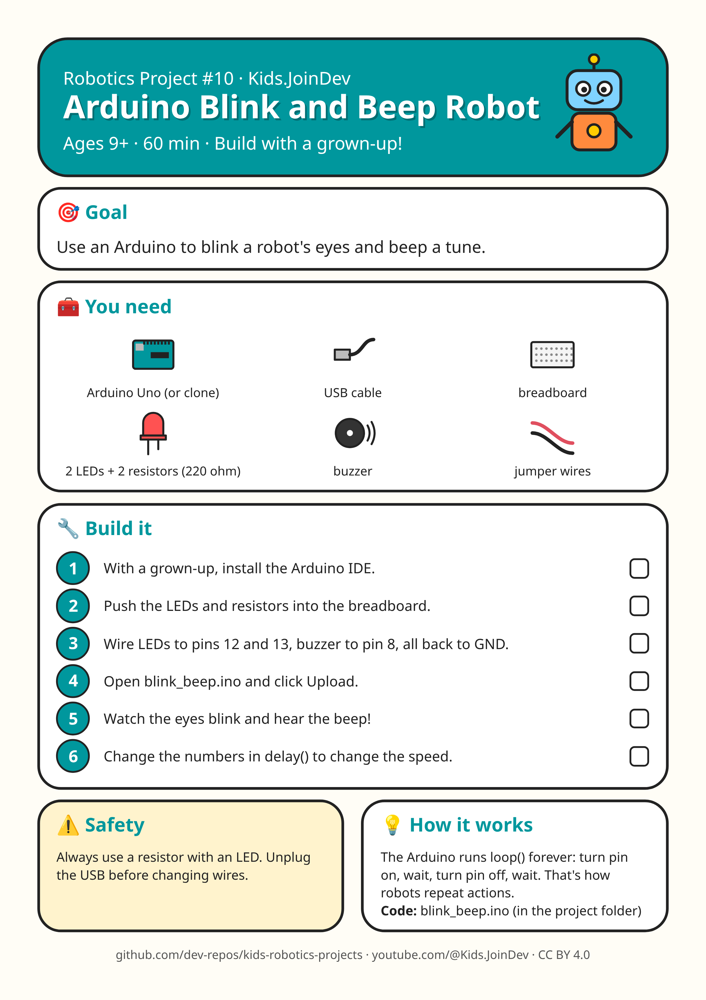

# Project 10: Arduino Blink and Beep Robot

**Ages:** 9+ · **Time:** 60 min · Build with a grown-up.



Printable A4 build-steps sheet: [card.png](card.png) · [card.pdf](card.pdf)

**1:1 cut/fold templates (print at 100% / Actual size, do not fit to page):** [templates.pdf](templates.pdf) (preferred) · [template 1 PNG](template-1.png). Check the 100 mm calibration bar first. Solid = cut, dashed = fold, grey circles = holes, red = size in mm.

## Goal

{p["goal"]}

## Parts list

- Arduino Uno (or clone)
- USB cable
- breadboard
- 2 LEDs + 2 resistors (220 ohm)
- buzzer
- jumper wires

## Steps

1. With a grown-up, install the Arduino IDE.
2. Push the LEDs and resistors into the breadboard.
3. Wire LEDs to pins 12 and 13, buzzer to pin 8, all back to GND.
4. Open blink_beep.ino and click Upload.
5. Watch the eyes blink and hear the beep!
6. Change the numbers in delay() to change the speed.

## Safety with a grown-up

Always use a resistor with an LED. Unplug the USB before changing wires.

## How it works

The Arduino runs loop() forever: turn pin on, wait, turn pin off, wait. That's how robots repeat actions.

## Coding piece

See [`blink_beep.ino`](blink_beep.ino).

```cpp
// Arduino Blink and Beep Robot
const int LEFT_EYE = 12, RIGHT_EYE = 13, BUZZER = 8;

void setup() {
  pinMode(LEFT_EYE, OUTPUT);
  pinMode(RIGHT_EYE, OUTPUT);
  pinMode(BUZZER, OUTPUT);
}

void loop() {
  digitalWrite(LEFT_EYE, HIGH);
  digitalWrite(RIGHT_EYE, LOW);
  tone(BUZZER, 523, 150);   // C
  delay(400);
  digitalWrite(LEFT_EYE, LOW);
  digitalWrite(RIGHT_EYE, HIGH);
  tone(BUZZER, 659, 150);   // E
  delay(400);
}
```

## Try next

Change one thing (size, weight, speed, number) and see what happens. Draw what you built!
