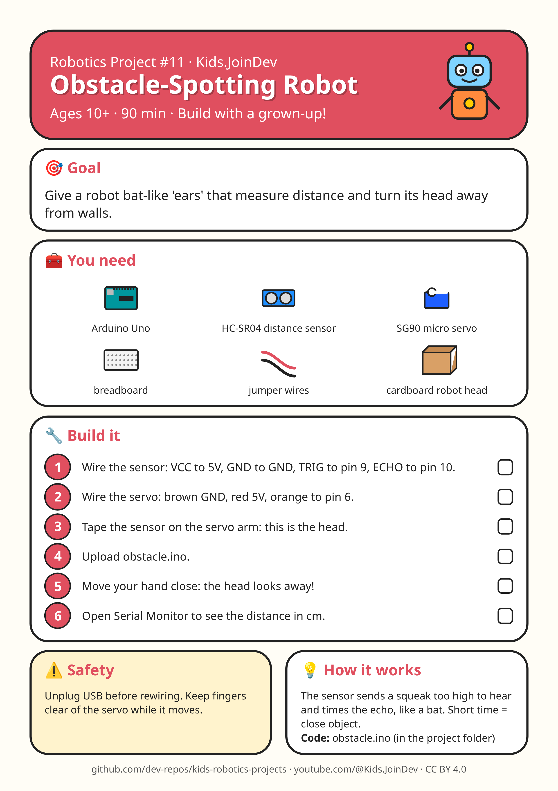

# Project 11: Obstacle-Spotting Robot

**Ages:** 10+ · **Time:** 90 min · Build with a grown-up.



Printable A4 build-steps sheet: [card.png](card.png) · [card.pdf](card.pdf)

**1:1 cut/fold templates (print at 100% / Actual size, do not fit to page):** [templates.pdf](templates.pdf) (preferred) · [template 1 PNG](template-1.png) · [template 2 PNG](template-2.png). Check the 100 mm calibration bar first. Solid = cut, dashed = fold, grey circles = holes, red = size in mm.

## Goal

{p["goal"]}

## Parts list

- Arduino Uno
- HC-SR04 distance sensor
- SG90 micro servo
- breadboard
- jumper wires
- cardboard robot head

## Steps

1. Wire the sensor: VCC to 5V, GND to GND, TRIG to pin 9, ECHO to pin 10.
2. Wire the servo: brown GND, red 5V, orange to pin 6.
3. Tape the sensor on the servo arm: this is the head.
4. Upload obstacle.ino.
5. Move your hand close: the head looks away!
6. Open Serial Monitor to see the distance in cm.

## Safety with a grown-up

Unplug USB before rewiring. Keep fingers clear of the servo while it moves.

## How it works

The sensor sends a squeak too high to hear and times the echo, like a bat. Short time = close object.

## Coding piece

See [`obstacle.ino`](obstacle.ino).

```cpp
// Obstacle-Spotting Robot: HC-SR04 + SG90 servo
#include <Servo.h>
const int TRIG = 9, ECHO = 10;
Servo head;

long distanceCm() {
  digitalWrite(TRIG, LOW);  delayMicroseconds(2);
  digitalWrite(TRIG, HIGH); delayMicroseconds(10);
  digitalWrite(TRIG, LOW);
  long t = pulseIn(ECHO, HIGH, 30000);
  return t / 58;            // microseconds -> cm
}

void setup() {
  pinMode(TRIG, OUTPUT);
  pinMode(ECHO, INPUT);
  head.attach(6);
  Serial.begin(9600);
}

void loop() {
  long d = distanceCm();
  Serial.println(d);
  if (d > 0 && d < 15) head.write(160);   // too close: look away
  else head.write(90);                    // all clear: look ahead
  delay(150);
}
```

## Try next

Change one thing (size, weight, speed, number) and see what happens. Draw what you built!
