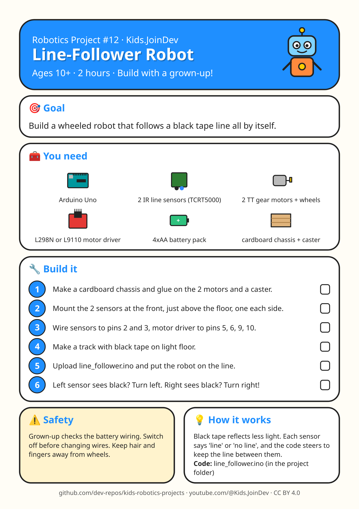

# Project 12: Line-Follower Robot

**Ages:** 10+ · **Time:** 2 hours · Build with a grown-up.



Printable A4 build-steps sheet: [card.png](card.png) · [card.pdf](card.pdf)

**1:1 cut/fold templates (print at 100% / Actual size, do not fit to page):** [templates.pdf](templates.pdf) (preferred) · [template 1 PNG](template-1.png) · [template 2 PNG](template-2.png). Check the 100 mm calibration bar first. Solid = cut, dashed = fold, grey circles = holes, red = size in mm.

## Goal

{p["goal"]}

## Parts list

- Arduino Uno
- 2 IR line sensors (TCRT5000)
- 2 TT gear motors + wheels
- L298N or L9110 motor driver
- 4xAA battery pack
- cardboard chassis + caster

## Steps

1. Make a cardboard chassis and glue on the 2 motors and a caster.
2. Mount the 2 sensors at the front, just above the floor, one each side.
3. Wire sensors to pins 2 and 3, motor driver to pins 5, 6, 9, 10.
4. Make a track with black tape on light floor.
5. Upload line_follower.ino and put the robot on the line.
6. Left sensor sees black? Turn left. Right sees black? Turn right!

## Safety with a grown-up

Grown-up checks the battery wiring. Switch off before changing wires. Keep hair and fingers away from wheels.

## How it works

Black tape reflects less light. Each sensor says 'line' or 'no line', and the code steers to keep the line between them.

## Coding piece

See [`line_follower.ino`](line_follower.ino).

```cpp
// Line-Follower Robot: 2 IR sensors + L298N/L9110 driver
const int LEFT_SENSOR = 2, RIGHT_SENSOR = 3;   // LOW/HIGH depends on sensor: test first!
const int L_FWD = 5, L_BACK = 6, R_FWD = 9, R_BACK = 10;
const int SPEED = 150;                          // 0..255

void drive(int left, int right) {
  analogWrite(L_FWD, left);  analogWrite(L_BACK, 0);
  analogWrite(R_FWD, right); analogWrite(R_BACK, 0);
}

void setup() {
  pinMode(LEFT_SENSOR, INPUT);
  pinMode(RIGHT_SENSOR, INPUT);
  pinMode(L_FWD, OUTPUT); pinMode(L_BACK, OUTPUT);
  pinMode(R_FWD, OUTPUT); pinMode(R_BACK, OUTPUT);
}

void loop() {
  bool leftOnLine  = digitalRead(LEFT_SENSOR)  == HIGH;  // most TCRT5000 boards: HIGH = black
  bool rightOnLine = digitalRead(RIGHT_SENSOR) == HIGH;
  if (leftOnLine && !rightOnLine)      drive(0, SPEED);      // turn left
  else if (rightOnLine && !leftOnLine) drive(SPEED, 0);      // turn right
  else if (!leftOnLine && !rightOnLine) drive(SPEED, SPEED); // line in middle: go
  else drive(0, 0);                                          // both black: stop (finish line)
}
```

## Try next

Change one thing (size, weight, speed, number) and see what happens. Draw what you built!
