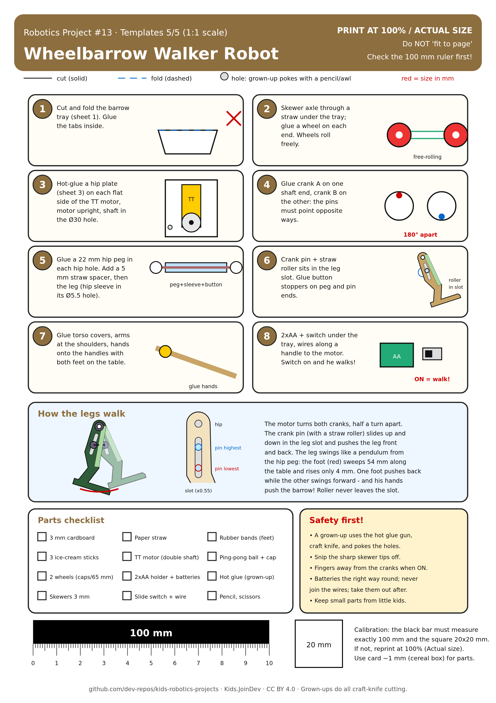

# Project 13: Wheelbarrow Walker Robot

**Ages:** 8+ · **Time:** 2–3 hours · Build with a grown-up.

Printable A4 build-steps sheet: [card.png](card.png) · [card.pdf](card.pdf)

**1:1 cut/fold templates (print at 100% / Actual size, do not fit to page):** [templates.pdf](templates.pdf) (preferred) · [sheet 1](template-1.png) barrow tray · [sheet 2](template-2.png) swing legs, feet, skewer/straw lengths · [sheet 3](template-3.png) hip plates, cranks, stoppers + true-size TT motor check · [sheet 4](template-4.png) torso, pads + 1:1 swing check · [sheet 5](template-5.png) build steps (SVG: `template-N.svg`). Check the 100 mm calibration bar first. Solid = cut, dashed = fold, grey circles = holes, red = size in mm.

## Goal

Build a cardboard and ice-cream-stick worker whose **legs really walk, driven by a motor**, pushing a free-rolling wheelbarrow. A TT gear motor sits upright in his hips. Its shaft sticks out on both sides, and each end turns a little crank. Each crank pin (with a straw roller) runs in a slot in a long cardboard leg that hangs from a hip peg, so the leg swings front-to-back like a pendulum (based on the 'Swing legs' design). The two cranks point opposite ways (180°), so the legs swing left, right, left, right.

## Parts list

- 3 mm corrugated cardboard (sheets 1, 3, 4)
- 3 ice-cream sticks (feet)
- 2 bottle caps or 65 mm wheels (they roll freely, no motor on them)
- Wooden skewers 3 mm (pins and axles) and a paper straw
- TT gear motor 3–6 V, **double shaft** (measured: body 66 mm long incl. motor can, gearbox 38 mm, 22 mm wide, white 5.4 mm D-shaft (3.7 mm across the flat) sticking out ~9 mm on both sides, 12 mm from the gearbox end, small 5 mm nub on the gearbox end). Sheet 3 has a true-size outline to check yours.
- 2xAA battery holder with batteries, slide switch, about 40 cm of thin wire
- 4 rubber bands (foot grips) or hot glue
- Ping-pong ball (head) and a bottle cap (hat)
- Hot glue (used by a grown-up), kid scissors, pencil

## The leg mechanism (key sizes)

| Part | Size |
|---|---|
| Crank radius (shaft centre to crank pin) | 8 mm, two cranks 180° apart (D-hole Ø5.4, flat 3.7) |
| Hip peg | Ø3 skewer, 22 mm, exactly 26 mm straight above the motor shaft, in each hip plate |
| Leg | Bent leg like sample #31: 2 layers of 3 mm cardboard glued (6 mm), 18 mm wide thigh angled back to a knee, shin angled forward to a long L-foot (54 mm: 42 toe forward + 12 heel, 8 mm thick); hip hole Ø5.5 (straw sleeve) at the top; hip to sole 88 mm. A pale ice-cream-stick link (~60 mm) is glued along the front edge of the thigh as a stiffener; a 54×10 mm sole stick + rubber bands go under the foot. Hip button and crank-pin button sit on the OUTSIDE face of each leg |
| Leg slot | 5.5 mm wide, centreline 13–39 mm below the hip hole (26 mm + round ends) |
| Crank pin + roller | Ø3 skewer 18 mm + 6 mm straw roller (Ø5) that runs in the slot; cardboard button stopper Ø10 |
| Spacer | 5 mm straw on each hip peg between plate and leg |
| Foot | 30 x 10 mm ice-cream stick, rubber-band grip |
| Shaft height above the table | about 62 mm (motor upright, can on top) |

As the crank turns, the pin slides 18–34 mm from the hip (5 mm spare at each end of the slot, so it never jams or falls out) and swings the leg ±17.9°. The foot sweeps **54.2 mm** front-to-back with only **4.3 mm** rise, a nearly flat line like the reference swing legs (54 mm / 4 mm). The script [tools/wheelbarrow_walker_check.py](../../tools/wheelbarrow_walker_check.py) checks this. Rubber-band grip feet and the worker leaning on the handles make the back-swinging foot push him forwards.

## Steps

1. Cut and fold the barrow tray (sheet 1). Fold the base tabs up and glue the side walls, back wall and sloped front flap on.
2. Glue the two axle hangers under the tray. Push the 110 mm skewer axle through a paper straw and through the hangers, add the Ø20 washers, then glue a wheel on each end. The wheels roll freely.
3. Cut the two hip plates (sheet 3, 3 mm cardboard). Cut the Ø30 hole out. Hot-glue one plate on each flat side of the TT motor, with the motor standing upright (gearbox at the bottom) and the shaft in the middle of the Ø30 hole. The second plate is the same shape glued flipped over, so the hip holes are on the same side (the back).
4. Make the cranks: glue the two A discs together, and the two B discs together (6 mm thick each). Push A onto one shaft end and B onto the other (the D-hole fits the flat of the shaft), with a drop of hot glue. Check that the crank pins point **opposite ways**. Glue an 18 mm crank pin into each pin hole.
5. Glue a 22 mm hip peg into each hip hole (sticking out sideways). Slide on a 5 mm straw spacer, then an 8 mm straw hip sleeve through the leg's Ø5.5 hip hole.
6. Put a 6 mm straw roller on each crank pin so it sits in the leg slot. Glue button stoppers on the ends of the pegs and pins (glue to the skewer, not the leg). Glue a foot across the bottom of each leg. Lay the leg on the 1:1 swing check on sheet 4.
7. Glue the torso covers (sheet 4) over the plates, and the head on top. Glue the upper arms to the shoulders and the forearms to the upper arms. With both feet flat on the table and the body upright, glue the hands to the barrow handles. The arms must be stiff: they are what pushes the barrow.
8. Glue the 2xAA holder on its pad under the tray and the slide switch on the switch plate. Run the wires along a handle and an arm to the motor. Switch on and he walks! If he walks backwards, swap the two motor wires.

**Foot grips:** wrap two rubber bands round each foot, or draw zig-zag lines of hot glue under it. A grippy foot pushes, and a slippery foot just slides.

**Tuning:** if the feet drag, glue a thin card shim under the barrow wheels' hangers so the barrow sits a bit higher. If he tips sideways, move the batteries further forward in the tray.

## Safety

- A grown-up uses the hot glue gun and does all craft-knife cutting and hole poking.
- Snip the sharp tips off skewers.
- Keep fingers and hair away from the cranks while the motor is on.
- Batteries: put them in the right way round, never connect the wires directly together, and take them out when you have finished.
- Keep small parts away from little children.

## How it works

The motor shaft turns each crank pin in a circle 8 mm from the centre. The pin's straw roller sits in a slot in the leg, so as it goes round it pushes the leg front and back while sliding up and down the slot. The leg hangs from a hip peg above, so it swings like a pendulum: the foot sweeps about 54 mm along the table and barely lifts (about 4 mm). Because the two cranks are 180° apart, one foot swings back (pushing) while the other swings forward. The worker's stiff arms are glued to the handles, so he pushes the free-rolling wheelbarrow along in front of him.
